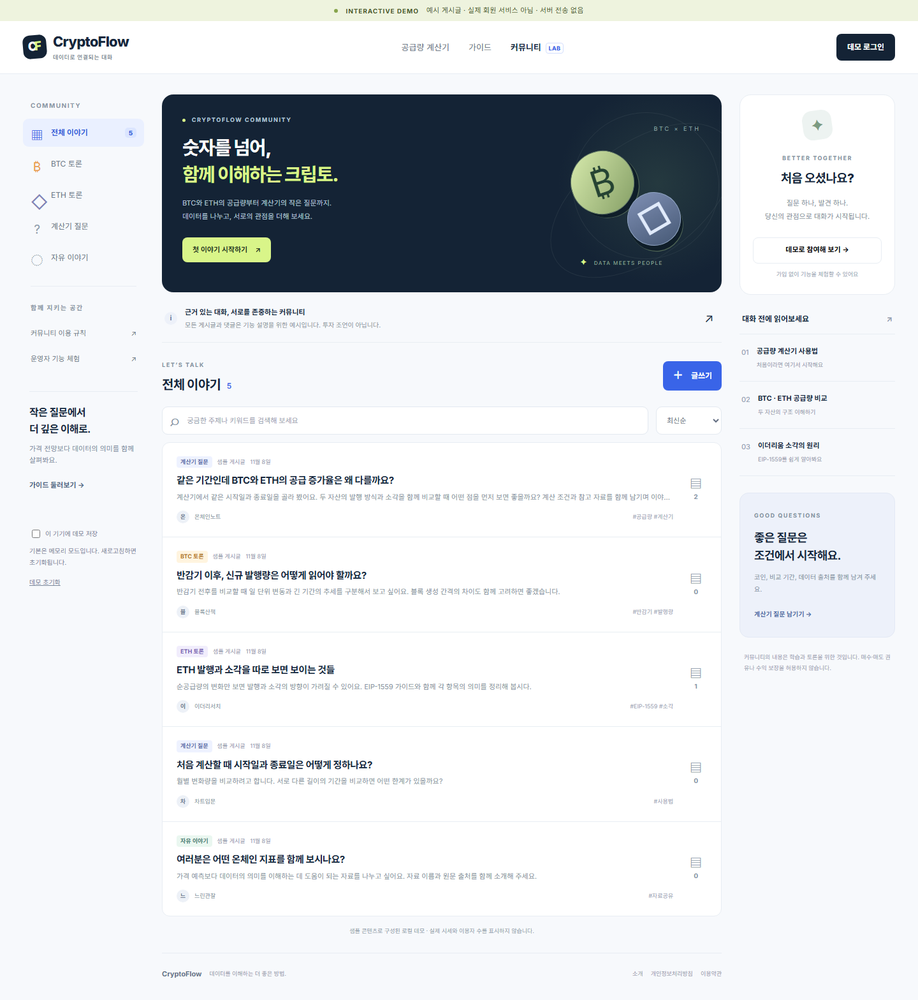

# CryptoFlow 커뮤니티 MVP 데모

BTC·ETH 공급량 계산기 이용자가 질문과 분석을 나누는 **한국어 브라우저 데모**입니다. 실제 회원 가입, 로그인, 서버, 공유 데이터베이스, 결제는 구현하지 않습니다. 화면의 회원/운영자 전환은 기능 체험용이며 인증이나 보안 기능이 아닙니다.

## 목표 우선순위

1. **Google AdSense 승인 준비**: 기존 계산기와 연결되는 독창적인 설명 콘텐츠, 명확한 출처·운영 정책·탐색 구조를 먼저 갖춥니다. 승인 여부는 Google이 판단하며 이 데모나 PR이 승인을 보장하지 않습니다.
2. **꾸준한 재방문**: 검증된 데이터 해설과 질문을 가이드로 발전시키는 운영 흐름을 만든 뒤 커뮤니티를 확장합니다. 자세한 기획은 [PRODUCT_PLAN.md](PRODUCT_PLAN.md)를 참고하세요.

데모는 `noindex,nofollow`이며 광고·분석 스크립트를 넣지 않습니다. 검색 색인이나 AdSense 신청용 운영 페이지가 아닙니다. 사용자 작성 내용은 자동 링크·업로드 없는 일반 텍스트로 다루며, 교육용 가이드로 이동하는 링크를 제공합니다. 최신/인기/공지와 제목·댓글 목록 같은 정보 구조만 참고하고 타 커뮤니티 게시물·밈을 복제하지 않습니다.

## 실행

저장소의 `community/index.html`을 브라우저에서 엽니다. 일반 스크립트를 사용하므로 빌드나 패키지 설치가 필요하지 않습니다. 로컬 파일 열기(`file://`)를 지원하는 브라우저에서 직접 열 수 있습니다. 브라우저별 로컬 저장 정책 차이를 피하려면 저장소 루트에서 다음과 같이 실행합니다.

```sh
python3 -m http.server 8000
# http://localhost:8000/community/
```

기존 계산기의 루트 `index.html`과 별도 경로이며, 가격 수정 PR과 독립적입니다. 이 변경만으로 운영 서비스가 개설되는 것은 아닙니다.

## 체험 흐름

1. 회원 모드에서 BTC / ETH / 계산기 / 자유 카테고리를 살펴보고 검색·정렬합니다.
2. 게시글과 댓글을 작성하고 부적절한 콘텐츠를 신고합니다.
3. 운영자 모드로 전환해 신고 대기열을 확인하고, 사유를 입력해 게시글·댓글을 숨기거나 복원합니다. 감사 로그에서 처리 내역을 확인합니다.
4. 데모 초기화로 샘플 상태로 돌아갑니다.

기본 상태는 메모리에만 유지되며 새로고침하면 초기화됩니다. 명시적으로 브라우저 저장 옵션을 선택한 경우에만 localStorage를 사용합니다. 로컬 저장은 같은 브라우저에서 재사용하는 편의 기능일 뿐 동기화·백업·비밀 저장소가 아닙니다. 공용 기기에서는 사용하지 말고 실명, 연락처, 지갑 비밀키 등 실제 개인정보를 입력하지 마세요. 다른 탭이나 기기의 변경 병합은 지원하지 않습니다. 운영자 전환이나 개발자 도구로 데이터에 접근할 수 있으므로 실제 신고 자료를 넣으면 안 됩니다.

## 파일 구성

- `index.html`, `styles.css`: 반응형 화면과 접근성 기본 구조
- `model.js`: 데모 데이터, 상태 변경 및 검증
- `app.js`: 화면 렌더링과 이벤트, 선택적 브라우저 저장
- `PRODUCT_PLAN.md`: AdSense 승인 준비와 재방문 목표의 단계별 기획
- `ARCHITECTURE.md`: 실제 다중 사용자 서비스를 위한 설계와 출시 조건
- `tests/browser.cjs`: 브라우저 흐름 검사와 `preview/desktop.png`, `preview/mobile.png`, `preview/moderation.png` 캡처 생성 스크립트
- `VERIFICATION.md`: 실제 수행한 검증과 미확인 항목
- `preview/desktop.png`, `preview/mobile.png`, `preview/moderation.png`: 설치 Chrome에서 실제 렌더링한 예시 화면

## 확인 방법

저장소 루트에서 Node.js 내장 테스트 러너로 모델 테스트를 실행합니다. 별도 테스트 의존성은 필요하지 않습니다.

```sh
node --test community/tests/model.test.cjs
```

브라우저에서는 작성 → 검색 → 댓글 → 신고 → 운영자 숨김/복원 → 초기화를 확인합니다. 저장 옵션을 끈 새로고침과 켠 새로고침을 각각 확인하고, 저장 차단 환경에서 오류 없이 메모리 모드로 동작하는지 점검합니다. 작은 화면, 키보드 탐색, 빈 입력·길이 초과, HTML 문자열의 일반 텍스트 표시도 확인합니다. Playwright와 해당 Chromium이 설치된 개발 환경에서는 `node community/tests/browser.cjs`로 브라우저 테스트를 실행할 수 있습니다. 시스템 Chromium을 사용할 때는 `CHROMIUM_EXECUTABLE_PATH=/usr/bin/chromium node community/tests/browser.cjs`처럼 경로를 지정합니다. 화면 캡처는 이 검사가 성공할 때 생성됩니다. 스크린샷은 시각 예시이며 기능·보안 검증을 대체하지 않습니다.

## 운영 전 필수 사항

GitHub Pages만으로는 공유 게시글의 접근 제어와 운영자 권한을 안전하게 구현할 수 없습니다. 실제 서비스에는 인증된 서버 API, PostgreSQL, 서버 측 권한 검사, 개인정보·신고 정책, 백업과 모니터링이 필요합니다. 상세 설계는 [ARCHITECTURE.md](ARCHITECTURE.md)를 참고하세요.

이번 범위에서는 유료 서비스 가입·설정, 계정 생성, main 병합, 운영 배포를 하지 않습니다. 운영 구축과 비용 발생은 별도 승인 후 진행합니다. 게시글과 예시는 투자 권유나 가격 예측이 아닙니다.

## 예제 화면



[모바일 뷰포트](preview/mobile.png) · [운영자 체험 화면](preview/moderation.png)

이 이미지는 실제 HTML 렌더링 캡처이며, 실제 회원 활동이나 운영 서비스의 화면이 아닙니다.
